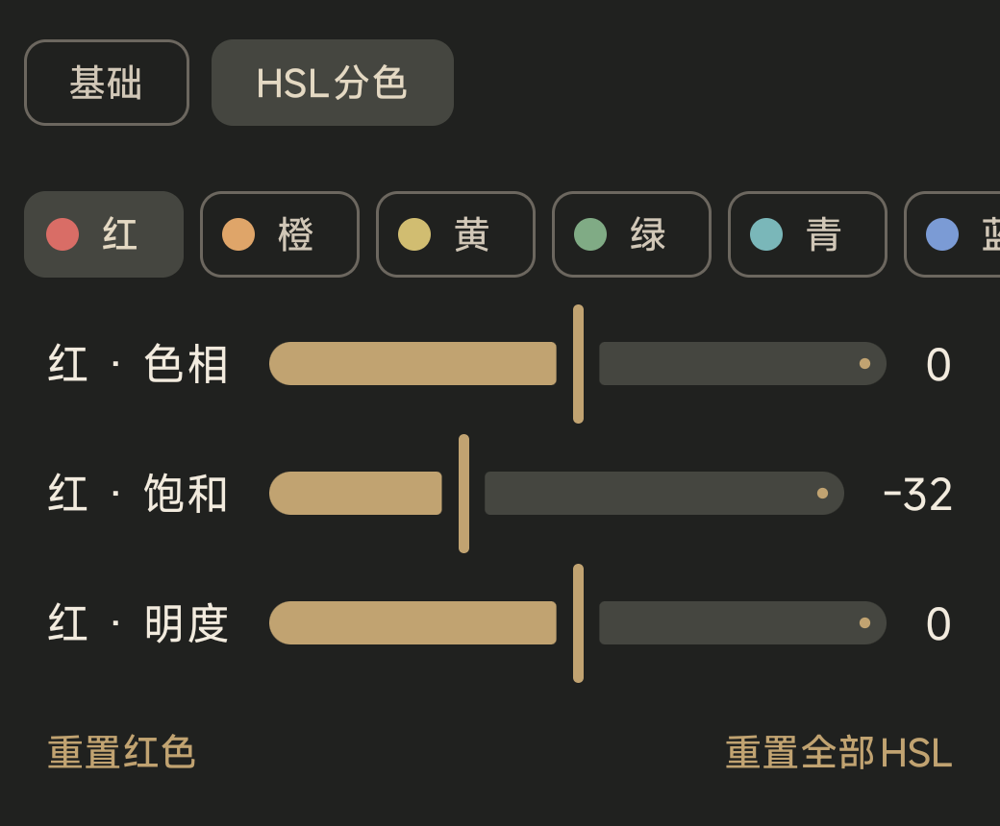
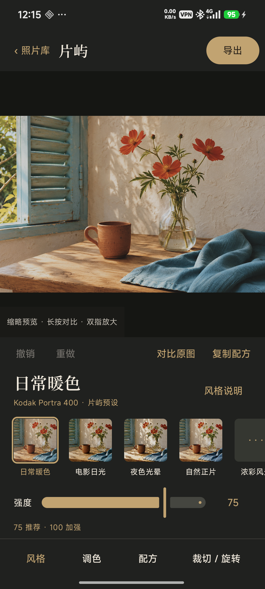
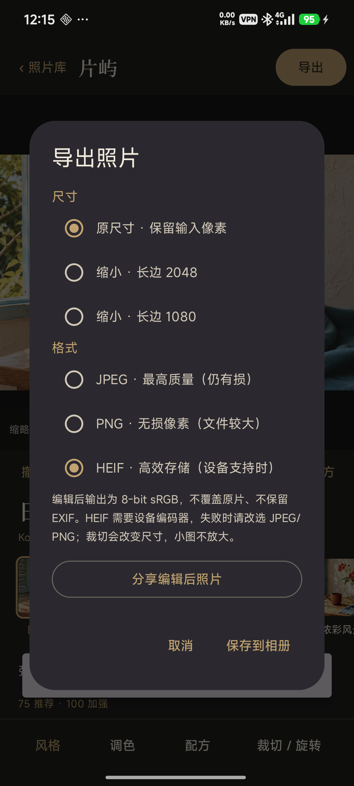
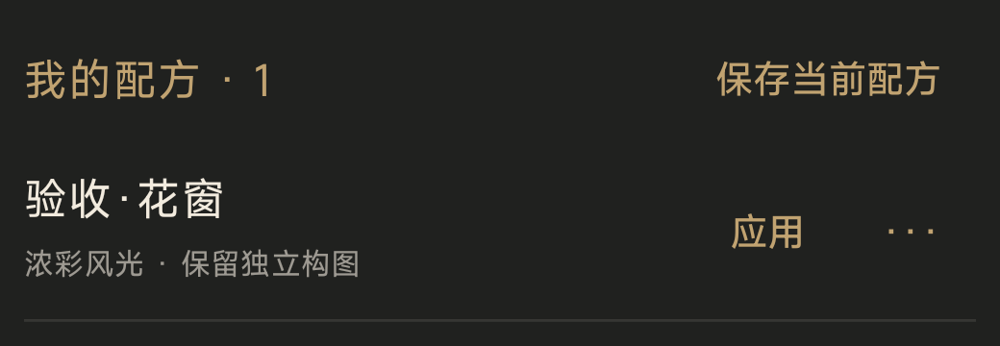

# 片屿 Pianyu

片屿是一款在 Android 手机上运行的胶片调色工具。用 15 款风格找到合适的影调，再调胶片曝光、相纸或电影拷贝片，以及印放曝光。支持 JPG、HEIF、手机 DNG、视频和 JPEG 实况照片。导入、编辑和导出都在设备上完成。


## 下载

最新版为 **0.3.4**，适用于 Android 10 及以上的 arm64 设备。胶片引擎使用 Vulkan。此版沿用之前公开测试版的签名，同签名旧版可直接覆盖安装。 [下载安装包](https://github.com/CommonerOfWestWall/pianyu/releases/download/v0.3.4/pianyu-0.3.4-arm64.apk) · [发布页与源码](https://github.com/CommonerOfWestWall/pianyu/releases/tag/v0.3.4)

[使用指南](docs/USER-GUIDE.md) · [本版功能和实测范围](docs/RELEASE-v0.3.4.md)

## 名字与视觉

“片”是照片，也是生活里的片刻；“屿”是一小块值得停留的日常。应用里的岛岸、日光与一片倒影，分别构成品牌标记的三层意象：岸线承接照片，日光提供方向，倒影留下片刻。它们不是滤镜名称，也不暗示某个真实胶片的唯一颜色。

## 已实现功能

- 从系统相册导入 JPG / HEIF；一次最多选择 100 张，私有照片库保存访问 URI 和编辑设置，不复制原片。
- 15 款风格入口：日常暖色、电影日光、夜色光晕、自然正片、浓彩风光、红蓝复古、柔和黑白，以及浅蓝淡彩、柔光人像、橄榄暖影、深青水色、暖金冷蓝、蓝紫暮色、深绿林地、灰青低彩。
- 风格强度、曝光、亮度、对比、饱和、高光、阴影、色温、色调、褪色、颗粒、锐化和暗角；HSL 分色支持红、橙、黄、绿、青、蓝、紫、洋红八个色区。
- 胶片曝光在胶片响应前以±2EV调节，直接使用上游模型；原曝光保留成片后的提亮作用。旧配方胶片曝光默认为0。已实际运行两个上游与片屿模型的同输入对照，见 [实验结果和边界](docs/UPSTREAM-PRACTICE-2026-11.md)。
- 新照片默认开启保护高光自动测光，在“调色 → 胶片曝光”可直接关闭；v13可手动选择均衡、中心、保护高光或保护阴影。推荐强度75与旧版推荐100等效（关闭测光比较），100进一步加强材料混合和额外预设。75不是准确率。旧配方不自动重新曝光。
- v13“调色 → 相纸与印放”保留推荐搭配，可更换兼容相纸/电影拷贝片，并独立调整±2EV印放曝光；支持撤销、配方保存和批量导出。正片直接扫描绕过相纸。选择另一风格会恢复该风格推荐冲印，其余手动调色保留。
- 风格强度、基础调色和 HSL 数值点按后可直接输入；曝光显示两位小数，其他参数使用 UI 百分数，并按各自范围校验后应用。未改动输入时保留原始浮点值。
- 裁切、移动裁切框、自由或锁定比例、左右 90° 旋转、水平/垂直镜像和 ±20° 校平。
- 撤销/重做、原图对比、长按对比、双指缩放；预览完成后可恢复全图。
- 复制/套用调色配方；命名配方可保存、应用、改名和删除，配方不包含几何构图。
- 单张保存或分享；照片库多选后批量保存，显示进度、结果和逐张失败原因，可以仅重试失败项或停止后续任务。编辑后可分享 JPEG、PNG 或设备支持时的 HEIF；另可直接分享原片，原片按源字节复制，保留原始元数据且不含编辑。
- 默认按原尺寸导出 8-bit sRGB JPEG（质量 100，高质量但仍有损），也可选择长边 1080 或 2048；另可导出编辑后的 8-bit sRGB PNG，或设备支持时的 8-bit sRGB SDR HEIF。HEIF 使用 AndroidX HeifWriter 1.1.0 和设备 HEVC/HEIC 编码器，不经过 JPEG 中转。不放大更小原图，写入 `Pictures/片屿`，编辑后导出不保留定位/EXIF 等元数据。
- DNG 在胶片模拟前由 LibRaw 提供高精度线性输入；普通视频输出 SDR MP4 并保留音频，编辑页展示抽帧预览。带内嵌视频的 JPEG 实况照片可同步处理封面与视频，也可单独另存 MP4；品牌私有封装和真实手机覆盖范围尚未广泛测试。
- 编辑预览长边约 960，预览尺寸不代表全分辨率输出。颗粒 UI 的 0–100 映射到引擎 0–2，拖动停顿约 120ms 后预览，松手提交；双指放大可观察颗粒，颗粒随风格强度变化。

## 正式版本的十五款风格

风格入口由 `app/src/main/java/studio/pianyu/app/Look.kt` 定义。参考材料只表示模型来源和审美方向，不是品牌合作、官方复刻或颜色保证。

| 入口 | 参考 | 说明 |
| --- | --- | --- |
| 日常暖色 | Kodak Portra 400 | Portra 400 负片与 Kodak Endura 相纸模型；偏暖、肤色柔和，适合日常和人物。 |
| 电影日光 | Kodak Vision3 250D | Vision3 250D 与 Kodak 2383 电影正片模型；适合街景、建筑和有方向的光。 |
| 夜色光晕 | CineStill 800T | 以 Vision3 500T 为基础的 800T 衍生模型与 2383，非独立测量的 800T；少量光晕，适合霓虹、灯光和夜景。 |
| 自然正片 | Fujifilm Provia 100F | 反转片模型，色彩相对清爽平衡，适合自然光和旅行。 |
| 浓彩风光 | Fujifilm Velvia 100 | 反转片模型，色彩更浓、对比更强，适合植物和风光。 |
| 红蓝复古 | Kodak Kodachrome 64 | 正片材料模型，保留克制的复古色彩，偏向街景和日常物件。 |
| 柔和黑白 | Fujifilm Neopan Acros 100 II | 黑白负片与 Ilford Multigrade IV RC 相纸模型；以灰阶、纹理和明暗关系为主。 |
| 浅蓝淡彩 | Fujifilm Provia 100F | 清淡的蓝青色调与柔和反差，适合自然光和海岸场景。 |
| 柔光人像 | Kodak Portra 400 | 柔和肤色与高光过渡，适合人物和日常光线。 |
| 橄榄暖影 | Kodak Vision3 250D | 暖色高光与橄榄暗部，适合街景和有方向的光。 |
| 深青水色 | Fujifilm Provia 100F | 深青与低饱和水色，适合旅行、天空和水面。 |
| 暖金冷蓝 | Fujifilm Velvia 100 | 暖金高光与冷蓝阴影，适合风光和植物。 |
| 蓝紫暮色 | Fujifilm Provia 100F | 蓝紫暮色与克制反差，适合傍晚和城市远景。 |
| 深绿林地 | Fujifilm Provia 100F | 压低亮绿、保留深绿层次，适合树林和阴影。 |
| 灰青低彩 | Kodak Portra 400 | 灰青低饱和与柔和反差，适合阴天和安静场景。 |



 

上面两图是 v12 在 Redmi K80 Pro 上的真机界面，照片为 AI 生成的内置示例，不是私人照片。旧 0.3 控件图仍保留作历史界面记录；未用合成照片替换截图里的照片来伪造运行结果。

## 使用流程

1. 在照片库点“从相册导入”或“导入”，从系统相册选择照片；点一张进入编辑，长按可多选。导入手机 DNG、普通视频或带嵌入视频的 JPEG 实况照片时，点“导入 RAW、视频或实况”并选择原文件。
2. 先选风格，从推荐75开始；需要更鲜明的效果可提高到100。“调色”默认打开成片曝光，首排可调曝光、对比、饱和和色温。调色顶排可直接切换到“胶片曝光”（含自动测光）、“相纸与印放”与“HSL”分色。“风格说明”列出参考材料，可关闭片屿额外预设，自行从胶片模型开始调色；重新选择风格会恢复推荐强度和预设。风格页的“重置此风格调色”会恢复此风格的默认调色并保留构图，可撤销。
3. 需要构图时打开“裁切 / 旋转”，完成后提交；点“取消”放弃本次构图。
4. 调好一张后，在“配方”页点“复制配方”，再回到照片库多选并“套用配方”。点“保存当前调色”可命名和复用配方。
5. 点“导出 → 保存到相册”使用当前的尺寸和格式。“更多设置”可切换尺寸、JPEG、PNG 或 HEIF。也可分享单张照片或在照片库多选后批量保存。导出期间请保持应用打开，进程被系统杀死后不会自动续传。

DNG 在胶片模拟前由 LibRaw 提供高精度线性输入，沿用照片编辑和导出流程。普通视频和 JPEG 实况照片进入独立编辑页，可调胶片风格、强度、胶片曝光、相纸或电影拷贝片、印放曝光。页面展示抽帧或封面，导出将固定颜色查找表用于整段视频，保留原有音轨并生成 SDR MP4。JPEG 实况导出会同步调色封面和内嵌视频，也可以单独另存 MP4。视频暂不应用空间颗粒与光晕，HEIC/AVIF 实况及各品牌的私有封装尚未接入，真实手机品牌覆盖范围未广泛测试。




## 构建

从源码构建 Android APK 前，先下载并校验固定的 LibRaw 0.22.2 源码。环境要求：JDK 17、Android SDK 36、NDK 28.2.13676358、CMake 3.22.1、Gradle 9.5.0；依赖版本见 `app/build.gradle.kts`。

```powershell
./engine/setup-libraw.ps1 -DependencyDirectory ./build/deps
./gradlew :app:assembleDebug
./gradlew :app:assembleRelease
```

Windows 工程路径需为 ASCII；若实际目录包含非 ASCII 字符，可用 `subst` 映射到临时盘符后执行 Gradle。Linux/macOS 先执行 `./engine/setup-libraw.sh ./build/deps`，再运行 `./gradlew`，需要能下载 Gradle/Maven 依赖。

应用构建默认使用源码包内已验证的 `app/src/main/jniLibs/arm64-v8a/libpianyu_core.so` 输入。要重建胶片核心，请先准备 NDK、CMake/Ninja、glslang 和 Vulkan Headers，再运行 [`docs/build-engine.ps1`](docs/build-engine.ps1)。该脚本在解压包根目录 staging，应用 Android unfused-FMA overlay，生成 Release arm64 核心并更新资源；它不依赖原开发工作区的相对路径。完整说明见 [`docs/SOURCE-DISTRIBUTION.md`](docs/SOURCE-DISTRIBUTION.md)。

## 隐私与数据

片屿无账户、广告、网络权限和照片上传。应用长期保存可重新访问的 URI、每张照片的编辑设置和应用私有的 `recipes-v1.json`。RAW 与实况导出可能暂存原始数据，处理结束后清理缓存中的临时文件。删除原图、撤销相册访问或清除应用数据后，需要重新导入。导出 JPEG 不保留定位、EXIF 等元数据。

## 已验证与限制

v12在Redmi K80 Pro完成最终Release APK再安装验证，确认最终UI、HEIF原尺寸保存与分享；7项host tests、21项定向 Android tests、Release 构建、AndroidTest 编译和 lint（0 errors、32 warnings、1 hint）通过。JPG和HEIF原尺寸处理及PNG保存/读取通过。之前版本的宣传视频基于 versionCode 7，不代表v12默认效果。50MP、HDR和尚未覆盖的其他设备编码器仍需单独验证。

v14通过16项host tests、17项定向Android测试，另完成18张连续原尺寸JPEG压力测试（6张各复制3份）及6张原尺寸HEIF导出。100张本地导入实际列表的首屏缩略图约2.01秒完成；主线程心跳不代表全程帧率。最终相同Release APK在Redmi K80 Pro通过实际UI保存原6张JPEG（全部4096×3072）、测光/相纸/印放与正片旁路检查。Debug/Release、AndroidTest编译和lint（0 errors、36 warnings、1 hint）通过；签名与本地v12一致。150张桌面受控实验及六组稳定版基线的条件见[研究报告](docs/METERING-PRINT-STUDY-v13.md)，驱动恢复和验证边界见[批量处理调查](docs/BATCH-PIPELINE-v14.md)。

- 当前范围不是 VSCO 的全功能替代品；没有透视、曲线、蒙版、相机、专业色彩管理、HDR 保真导出或后台批处理服务。
- 本地 GPU 兼容性在 Redmi K80 Pro / Adreno 830 验证；OPPO Find X9 有用户正常使用反馈。没有 CPU 后备渲染，不能保证所有 Vulkan/GPU 设备兼容。
- Ultra HDR JPEG 可使用其 SDR 底图调色，当前成片管线使用 8-bit sRGB。10-bit/HDR HEIF 是否可读取决于设备解码器。
- DNG、普通视频和 JPEG 实况照片已接入，但其他 RAW 容器、HEIC/AVIF 实况及各品牌私有封装仍未覆盖；视频导出为 SDR MP4，保留原音轨。
- 公开版演示输入为 AI 生成的手机摄影风格 PNG 加内置 stilllife，不是实拍或真实人物背书。参考、AI输入与实际 Android 输出分别标注；编辑结果未经额外调色，不用于证明真实胶片定标。界面录制使用公开内置示例；测试输入只随 AndroidTest 包提供。
- AndroidTest 中的合成样片和测试输入只随测试包提供。

## 来源与分层许可

- 应用、Android 界面和本项目修改代码：GPL-3.0-or-later，见 [`license/LICENSE`](license/LICENSE) 和根目录 [`NOTICE.md`](NOTICE.md)。
- [SpektraLab](https://github.com/JamesQiu2005/SpektraLab) 固定上游提交：[`d90cf9a`](https://github.com/JamesQiu2005/SpektraLab/commit/d90cf9a005d5c7eb4c0bc1eb9cac17459c2a9289)。引擎还包含 Windows/Vulkan 局部修改和 Android overlay，差异随源码包提供。
- 上游截至 2026-11-10 的 3 个提交、引擎未变更结论和商标边界见 [`docs/UPSTREAM-REVIEW-2026-11.md`](docs/UPSTREAM-REVIEW-2026-11.md)。
- spektrafilm profiles、LUT 及直接派生数据：CC BY-SA 4.0，见 [`license/SPEKTRAFILM_LICENSE.txt`](license/SPEKTRAFILM_LICENSE.txt)；该文件及 `license/NOTICE.md` 保留原文。
- Material Icons 为 Apache-2.0；Noto Serif SC 子集为 SIL OFL 1.1；Vulkan-Headers、volk 及其他第三方组件按各自目录许可证提供。来源记录见 [`asset-provenance/`](asset-provenance/)。

请先阅读各目录中的许可证和 NOTICE，再重新分发或修改相应内容。

## 致谢

感谢 Andrea Volpato 的 [spektrafilm](https://github.com/andreavolpato/spektrafilm)、[SpektraLab](https://github.com/JamesQiu2005/SpektraLab) 上游工程、Vulkan/volk、Google Material Icons 和 Noto Serif SC。片屿没有沿用网友安卓版的 UI 或二进制核心。

## 参与贡献

请先阅读 [`CONTRIBUTING.md`](CONTRIBUTING.md)。欢迎性能分析、无障碍改进、设备兼容性报告和可复现构建修复；请保留来源记录、测试输入和许可证边界，避免新增仅靠名称区分的相似风格入口。

白马样片在追加比较 19 个候选后，改用自然正片重新输出 4 个累计阶段；[重调前后对比与完整参数](docs/film-study/PRAIRIE-REVISION.md) 保留旧版，视频已同步更新。
