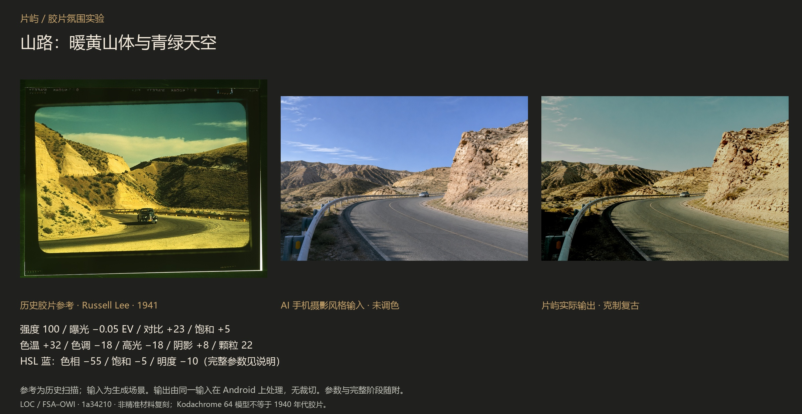
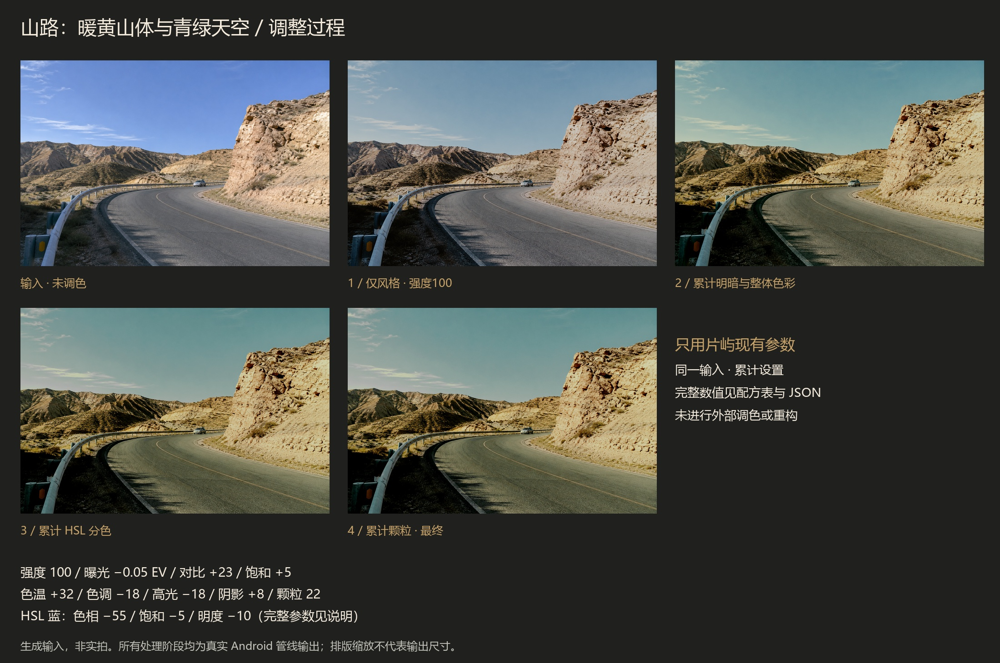
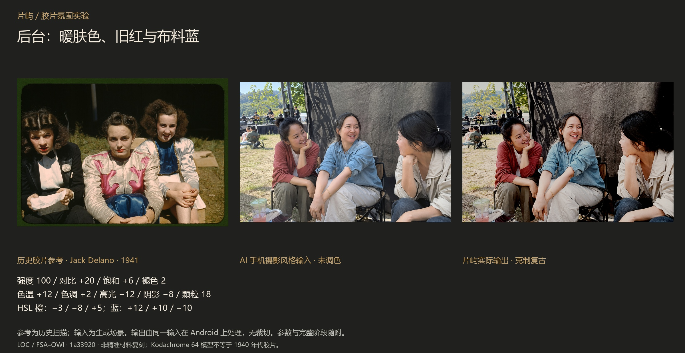
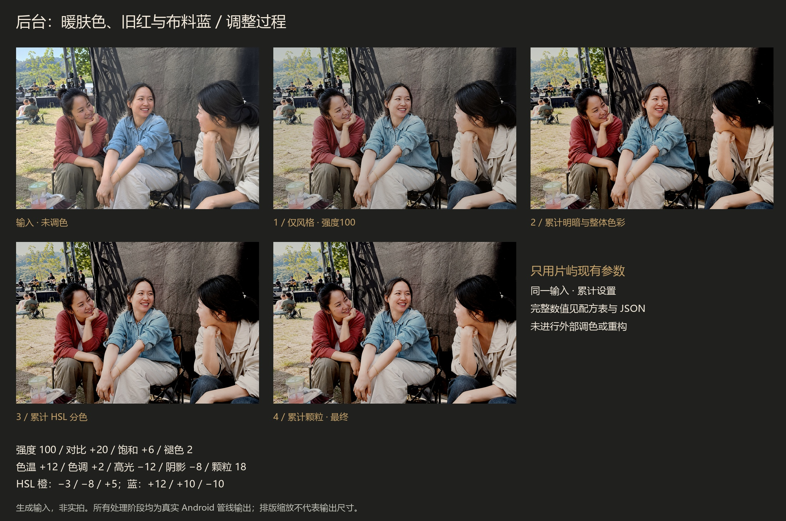
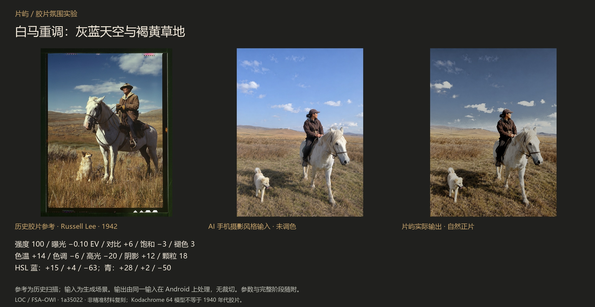
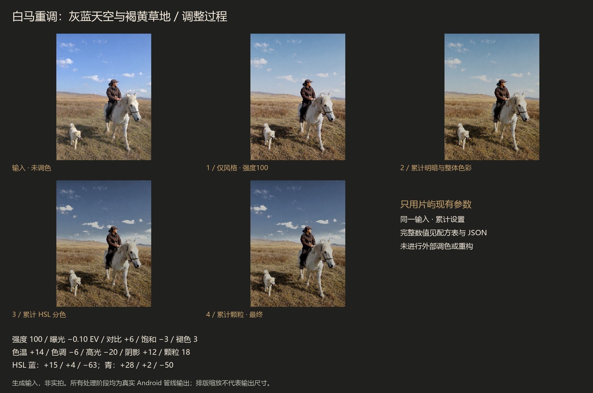

# 片屿：把胶片时代的色彩关系带回日常

> 历史实验记录：本页样片与参数来自早期0.3.2候选，并非v12默认效果。比较图与JSON随源码公开；文中提到的完整研究压缩包并非本次v0.3.2 Release资产。复现历史结果需使用对应版本设置，不能把表中强度直接当作v12推荐起点。

这是一组审美实验，不是胶片材料的色度标定。三张历史参考选自美国国会图书馆 [Bound for Glory](https://www.loc.gov/exhibits/bound-for-glory/exhibition-items.html) 展览。输入是明确标注的 AI 生成手机摄影风格场景，**不是实拍**。最终调色只使用片屿现有的风格、明暗、HSL 和颗粒功能；没有用 AI 生成成片、外部 LUT、颜色迁移或修图软件追加调色。

## 如何阅读与复现

每组保留输入 PNG、历史参考原下载文件、四个累计阶段、完整 JSON 和真机 runner 日志。先看原图 → 风格 → 明暗 → HSL → 颗粒。每个阶段都从同一原始输入重新渲染累计设置，不是在上一张导出照片上反复叠加。整张构图保持不变；展示图仅等比缩放排版，未改色。

界面数值：曝光直接使用 EV；其余滑块将 JSON 小数乘 100，例如 warmth .32 对应色温 +32。HSL 每个色区按色相、饱和、明度列出；0 表示不调整。颗粒仍随风格强度变化。JSON 是完整实验记录，**当前版本没有 JSON 配方导入入口**，普通用户按表手动设置并保存命名配方。

开发者复现：按 docs/RECIPE-STUDY.md 把每组 input.png 与 recipes.json 放到应用私有 recipe-study/<study>/，指定 RecipeStudyDeviceTest 和 study 参数运行。APK 与管线文件哈希见 audit.json。颗粒与 GPU 浮点输出不承诺跨设备逐字节一致；哈希用于核对这次实际导出的文件。

## 山路：暖黄山体与青绿天空

历史参考：Russell Lee · 1941，[1a34210](https://hdl.loc.gov/loc.pnp/fsac.1a34210)。参考文件保留扫描边框，不补色、不修复。

选用 **克制复古，强度 100**。

| 参数 | 界面值 |
| --- | ---: |
| 曝光 EV | -0.05 |
| 亮度 | 0 |
| 对比 | 23 |
| 饱和 | 5 |
| 色温 | 32 |
| 色调 | -18 |
| 高光 | -18 |
| 阴影 | 8 |
| 褪色 | 0 |
| 颗粒 | 22 |
| 锐化 | 0 |
| 暗角 | 0 |

| HSL 色区 | 色相 | 饱和 | 明度 |
| --- | ---: | ---: | ---: |
| red | 0 | 0 | 0 |
| orange | 0 | 0 | 0 |
| yellow | 8 | 10 | -3 |
| green | -30 | -20 | -8 |
| cyan | -20 | -10 | -5 |
| blue | -55 | -5 | -10 |
| purple | 0 | 0 | 0 |
| magenta | 0 | 0 | 0 |

颗粒阶段与上一阶段有 86.3% 像素发生变化，RGB 平均绝对码值差为 3.014。这是变化记录，不是“胶片真实度”评分；应结合原尺寸局部观察。

## 后台：暖肤色、旧红与布料蓝

历史参考：Jack Delano · 1941，[1a33920](https://www.loc.gov/item/2017877399/)。参考文件保留扫描边框，不补色、不修复。

选用 **克制复古，强度 100**。

| 参数 | 界面值 |
| --- | ---: |
| 曝光 EV | 0 |
| 亮度 | 0 |
| 对比 | 20 |
| 饱和 | 6 |
| 色温 | 12 |
| 色调 | 2 |
| 高光 | -12 |
| 阴影 | -8 |
| 褪色 | 2 |
| 颗粒 | 18 |
| 锐化 | 0 |
| 暗角 | 0 |

| HSL 色区 | 色相 | 饱和 | 明度 |
| --- | ---: | ---: | ---: |
| red | 0 | 0 | 0 |
| orange | -3 | -8 | 5 |
| yellow | 0 | 0 | 0 |
| green | -20 | -25 | -10 |
| cyan | 0 | 0 | 0 |
| blue | 12 | 10 | -10 |
| purple | 0 | 0 | 0 |
| magenta | 0 | 0 | 0 |

颗粒阶段与上一阶段有 80.9% 像素发生变化，RGB 平均绝对码值差为 2.660。这是变化记录，不是“胶片真实度”评分；应结合原尺寸局部观察。

## 白马重调：灰蓝天空与褐黄草地

历史参考：Russell Lee · 1942，[1a35022](https://www.loc.gov/item/2017878800/)。参考文件保留扫描边框，不补色、不修复。

选用 **自然正片，强度 100**。

| 参数 | 界面值 |
| --- | ---: |
| 曝光 EV | -0.1 |
| 亮度 | 0 |
| 对比 | 6 |
| 饱和 | -3 |
| 色温 | 14 |
| 色调 | -6 |
| 高光 | -20 |
| 阴影 | 12 |
| 褪色 | 3 |
| 颗粒 | 18 |
| 锐化 | 0 |
| 暗角 | 0 |

| HSL 色区 | 色相 | 饱和 | 明度 |
| --- | ---: | ---: | ---: |
| red | 0 | 0 | 0 |
| orange | 0 | -8 | -2 |
| yellow | -4 | -2 | -8 |
| green | -8 | -30 | -8 |
| cyan | 28 | 2 | -50 |
| blue | 15 | 4 | -63 |
| purple | 0 | 0 | 0 |
| magenta | 0 | 0 | 0 |

颗粒阶段与上一阶段有 84.4% 像素发生变化，RGB 平均绝对码值差为 2.748。这是变化记录，不是“胶片真实度”评分；应结合原尺寸局部观察。

## 看过结果后的判断

山路的青绿天空、暖黄山体与深色道路已经形成明确方向，但仍比历史扫描更干净，天空和阴影的层次也不同。人物保留了暖肤色、旧红与蓝色衣料的关系，第一轮过暖过暗的方案已放弃；新的光线没有变成历史照片的强直射光。白马样片又比较了19个候选，改用自然正片重新输出4个累计阶段，收回偏亮的天空和偏橙的草地；灰蓝与褐黄更接近参考方向，但局部明暗、原有光线与扫描质地仍不同。这些差异不靠加黄或加颗粒就能解决。

七种基础风格在部分照片上确实仍相近。这组实验说明**完整配方比只换材料名称更能形成明确风格**，不证明七个入口已经充分区分，也不证明胶片材料复刻准确。后续风格精简应以多种真实用户照片再验证。

## 来源与边界

历史参考：[美国国会图书馆展览](https://www.loc.gov/exhibits/bound-for-glory/exhibition-items.html)，FSA/OWI Color Photographs。馆方列为 public domain / No known restrictions on publication。署名 Library of Congress, Prints & Photographs Division, Farm Security Administration/Office of War Information Color Photographs；每组保留摄影师、年代与数字编号。

生成输入可在法律允许的范围内以 CC0 使用；历史参考依其原有公有领域状态，不重新授权为应用原创。生成简报在 audit.json 中明确标为事后整理，不假称原始提示词全文。这不是用真实手机拍摄的验证，仍需真实用户照片进一步检验。

人物没有磨皮、五官或身体重构。所有几何参数均为默认；色彩不能替代内容、构图和原有光线。界面预览约960长边，本次研究输入最大1536，完整输出保留各自像素尺寸，非50MP性能测试。

完整输入、各阶段 PNG、历史参考与核对记录见 [0.3.2 发布资产中的 pianyu-film-study.zip](https://github.com/CommonerOfWestWall/pianyu/releases/tag/v0.3.2)。文中表格为最终累计值；各阶段 JSON 位于 [film-study](film-study/) 目录。

白马旧版与重调版对比、完整参数和差异说明见 [白马重调记录](film-study/PRAIRIE-REVISION.md)。
