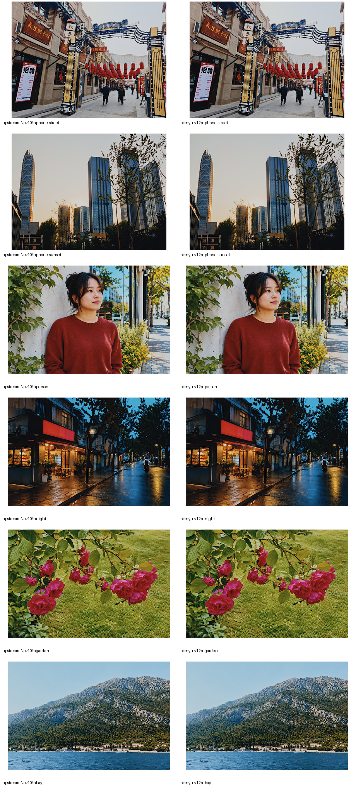
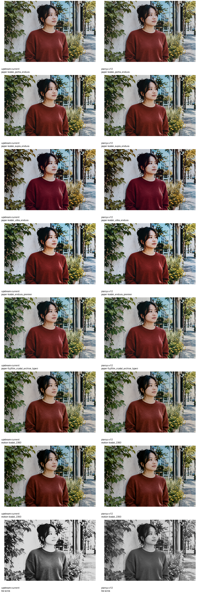
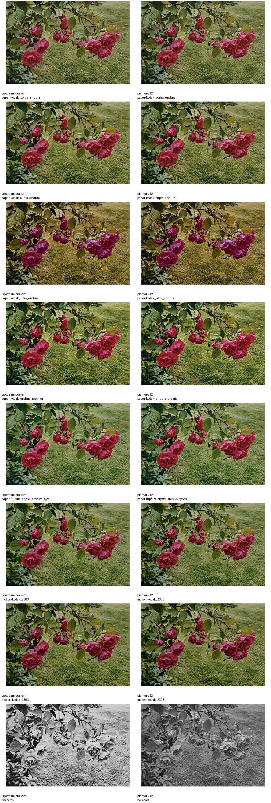
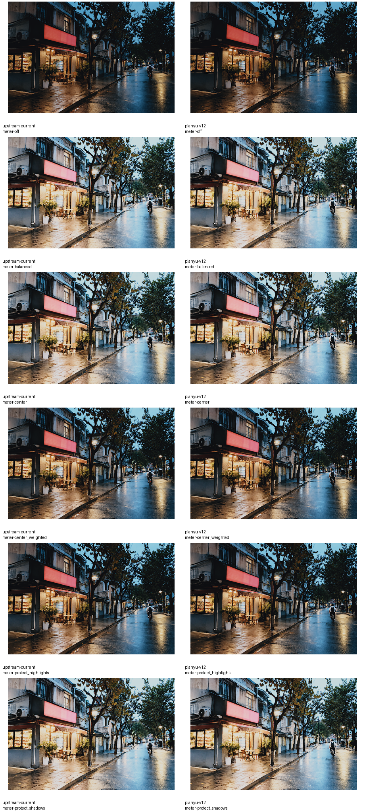
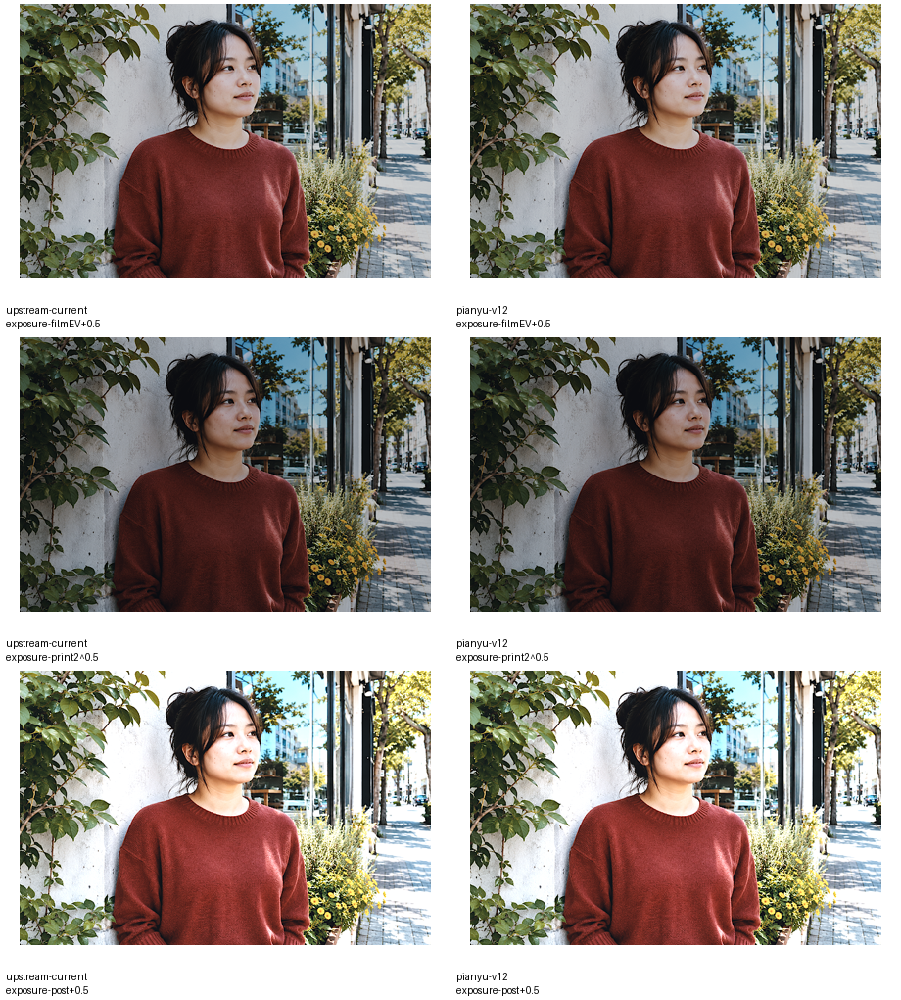

# 测光与冲印：同图实验及v13候选实现

2026-11-16。结论来自实际原生引擎输出、逐图查看及参数记录。**合并选择入口，保留材料差异；三种曝光按处理阶段分开。** 首页仍是七个推荐搭配，手动页才展开测光、相纸与印放。

## 比较的是什么

| 对象 | 固定版本与条件 |
| --- | --- |
| 当前官方SpektraLab源码 | [`87de3b6`](https://github.com/JamesQiu2005/SpektraLab/tree/87de3b6c837f9e21ad67924c50b169b3bacbfc5e)，独立编译Windows/Vulkan DLL |
| 片屿参考引擎 | 11月10日构建的片屿桌面同源引擎，使用v12确切资源；本轮不替换Android核心 |
| 稳定版上游补充基线 | 11月10日上游未改引擎，与片屿保持方向耦合开启，再比六张Portra场景 |
| 输入 | 街道、夕阳城市、人像、雨夜、花园、海湾六张AI生成的手机摄影风格图，不是实拍；长边640，EXIF转正、RGB/sRGB输入；人像另复核960 |
| 控制变量 | 两边同图同参数；关闭颗粒、光晕、眩光、场景宽容度，避免纹理及随机性影响材料比较；不加入片屿额外预设、强度混合及个人HSL |

当前官方的Windows/Vulkan构建在开启方向耦合时出现异常黑红图。复现后查到：新的模糊混合路径用空缓冲表示零累加，但Vulkan累加shader仍读取占位输入。关闭方向耦合后恢复正常，旧11月10日构建开启方向耦合也正常。因此：

- 初轮异常图全部作废，不据此说上游颜色差。
- 150张受控实验**两边都明确关闭`dir_couplers_active`**。它能比较测光、曝光和材料的差异，不能冒充官方Mac应用默认截图。
- 另做方向耦合开启的旧版基线，补充检查既有路径；候选APK继续用原来已验证的核心，不引入这个新缺陷。

资源按官方[`bw_checks.py`](https://github.com/JamesQiu2005/SpektraLab/blob/87de3b6c837f9e21ad67924c50b169b3bacbfc5e/engine/tests/bw_checks.py)的方式，将`resources_product/profiles`覆盖到当前官方资源副本，避免漏掉产品层黑白profile。不是拿片屿资源替换官方资源。参数与处理阶段可对照官方[`FilmParams.swift`](https://github.com/JamesQiu2005/SpektraLab/blob/87de3b6c837f9e21ad67924c50b169b3bacbfc5e/app/SpektraLab/Sources/Model/FilmParams.swift)和[`pipeline.cpp`](https://github.com/JamesQiu2005/SpektraLab/blob/87de3b6c837f9e21ad67924c50b169b3bacbfc5e/engine/src/pipeline/pipeline.cpp)。

## 结果与边界

150张受控输出全部成功，对应75组两引擎同图比较。主线程重新核验全部输入/输出SHA256；75组输入一致。72组输出浮点数组相同，另3组是Acros黑白；后者RGB平均绝对差分别为花园0.16334、人像0.11385、夜景0.07647（范围0—1）。这些是**两条处理管线的差异，不是胶片准确率**。

Acros材料profile散列相同，整个资源包的LUT与构建版本并不完全相同。本轮尚未隔离其具体原因，不能归因为“新黑白更准”或“旧黑白错误”。保留现有黑白效果，不随便升级模型。彩色受控实验的相同结果也不代表全部功能、全部胶片或全部设备都一致。

旧版上游与片屿的六组Portra基线逐像素一致；960人像受控对照的PNG SHA256也一致。这证明本轮比较范围内材料及控制能复用，没有证明真实胶片标定准确，更不能证明Android各GPU的结果都相同。



## 哪些合并，哪些分开

| 项目 | 实践观察 | 产品决定 |
| --- | --- | --- |
| Portra / Supra Endura | 人像及花园比较接近；Supra仍有反差和颜色差异，夜景也不同 | 首页不新增近似风格；Portra保留推荐，Supra放“更多相纸”，不删除模型 |
| Ultra Endura | 三场景都有明显变化；花园更浓、更暖黄，红花更深；夜景反差更强 | 保留直接选项，用于主动加强反差及色彩 |
| Endura Premier | 比推荐更有反差和色彩，不能视为Supra同义词 | 保留在“更多相纸”，避免把所有纸种平铺成首页滤镜；位置是交互取舍，不是低质排名 |
| Fuji Crystal Archive Type II | 与Portra的整体数值距离较小，但绿色、肤色及冷暖关系不同 | 保留直接选项，提供另一种色彩方向；不是全场景都偏冷的保证 |
| 2383 / 2393 | 人像、花园、夜景可见颜色和明暗差异 | 在电影风格内分别保留，标成“电影拷贝片”，不混称相纸 |
| 正片扫描 / 相纸冲印 | Provia在两场景、两引擎中更换相纸和印放曝光均逐像素不变 | 正片页明确“不经过相纸”，不提供无效滑块；不删除正片路径 |
| 四种测光 | 某些场景计算相同，夜景和高反差场景明显分开 | 保留均衡、中心、保护高光、保护阴影；旧中央加权仅兼容旧编辑 |
| 胶片 / 印放 / 成片曝光 | 同为+0.5EV，明暗和色彩行为不同，甚至明暗方向不同 | 保留三个阶段，不折叠成一个“味道”或亮度滑块 |

相纸与推荐Portra输出的RGB平均绝对差，仅作区分度佐证：

| 场景 | Supra | Ultra | Premier | Fuji Type II |
| --- | ---: | ---: | ---: | ---: |
| 人像 | 0.01597 | 0.04034 | 0.04622 | 0.01487 |
| 花园 | 0.01485 | 0.05231 | 0.03736 | 0.01742 |
| 夜景 | 0.01901 | 0.03992 | 0.03739 | 0.01630 |

数值距离不等于视觉差异的全部，更不等于好看程度，所以不能只按一个阈值删除相纸。这次是折叠菜单，不是把两种材料的数据平均成一种。





## 为什么测光模式需要保留

下表是引擎实际返回的自动曝光EV，两边相同。不是给按钮人为安排的固定补偿：

| 场景 | 均衡 | 中心 | 旧中央加权 | 保护高光 | 保护阴影 |
| --- | ---: | ---: | ---: | ---: | ---: |
| 街道 | +0.2275 | +0.3027 | −0.5869 | +0.0578 | +1.0935 |
| 夕阳城市 | +0.3430 | −0.0348 | −0.9685 | +0.2005 | +1.2565 |
| 人像 | +0.2383 | +0.4368 | −0.1879 | +0.2167 | +0.2383 |
| 雨夜 | +2.2514 | +2.1536 | +1.0541 | +0.8782 | +2.3222 |
| 花园 | +0.0089 | −0.0293 | −0.2607 | +0.0089 | +0.0089 |
| 海湾 | +0.0228 | +0.2925 | −0.2480 | +0.0228 | +0.0228 |

雨夜的均衡与保护阴影明显抬亮街道，保护高光更保留暗部气氛，关闭则保持原片曝光起点。这支持继续以保护高光作为片屿起点，同时把选择权交给手动调节。不是认定所有夜景都该暗，也不是自动识别舞台/人像的AI功能。

新`center`和旧`center_weighted`不是同一个模式。旧配方不能静默映射到新中心测光。



## 曝光数值与原理怎样对应

胶片曝光在胶片响应前补偿，用上游`exposure_compensation_ev`；自动测光先确定起点，手动EV再叠加。0EV表示不额外补偿，不表示没有胶片风味。

印放曝光改变相纸/拷贝片受到的光量。界面用EV，传入引擎的是`print_exposure = 2^EV`：+0.5EV为√2，0EV为1。原有印放归一化保持不变。负片到相纸的处理不是简单提亮，实验中增加印放曝光让人像压暗。

原“曝光”在成片阶段提亮/压暗。本轮对照确实在原生输出后乘√2，未用未改变的底图冒充成片+0.5EV。这一阶段不重新改变胶片感光响应，不能替代前两个阶段。



## 已落实到候选应用

- 首页七风格及其推荐搭配不变，强度起点75、轻颗粒、保护高光自动测光不变。
- “调色 → 胶片曝光”新增四种测光选择，自动测光开关和手动EV保留。
- “调色 → 相纸与印放”提供推荐材料、直接选项、“更多相纸”、±2EV印放曝光和可撤销的恢复推荐。
- 当前只开放本轮验证的搭配组：彩色相纸、电影拷贝片、黑白相纸。不是宣称电影负片物理上不能印到彩色相纸；跨组创作尚未纳入这轮产品验证。
- 正片直接扫描不显示无效纸种和印放滑块。更换风格恢复对应推荐冲印，其他手动调节保留。
- 新设置贯通保存/恢复、缓存、撤销、配方、单张及批量导出；旧编辑缺字段时跟随原推荐材料、印放0EV，不改变旧效果。旧版中央加权仍可恢复。

这次特色在于“推荐搭配为起点，必要时再进入冲印层”，并保留可记录的真实阶段参数；没有另造一批相似滤镜，也不把调亮和加饱和称作新的胶片科学。

## 数据与验证

便携证据位于[`studies/meter-print-v13/`](studies/meter-print-v13/)：六张**实际640输入副本**、未调色接触表、[`cases.csv`](studies/meter-print-v13/cases.csv)、[`baseline.csv`](studies/meter-print-v13/baseline.csv)和[`evidence.json`](studies/meter-print-v13/evidence.json)。JSON记录两个DLL SHA256、上游SHA、每例完整resolved参数、输入/输出散列、旁路及960复核结果；没有本机绝对路径。接触表只用于查看，精确比较使用原输出数组。

v13初次候选检查：12项host tests通过；Debug/Release APK、AndroidTest APK编译和lint通过（0 errors、36 warnings、1 hint）。当时没有连接设备或可用模拟器，未执行新增设备测试或新界面验收。

v13首次候选版本为`0.3.3-preview`、versionCode 13。2026-11-16已在后续`0.3.3-preview2` / versionCode 14补齐Redmi K80 Pro真机验证：4项`FilmPrintDeviceTest`通过；最终压缩Release实际切换四种测光、关闭/开启测光、切换Ultra Endura及Crystal Archive、设置+0.4EV印放并恢复推荐，确认正片不经过相纸，最后恢复示例默认。另完成原尺寸JPEG/HEIF和批量导出，具体范围及限制见[批量处理记录](BATCH-PIPELINE-v14.md)。

沿用开发测试签名和arm64/Android 10+范围，后续v14以独立`v0.3.3-preview2`公开测试标签发布，历史v12保留。可重跑设备测试：

```powershell
./gradlew :app:connectedDebugAndroidTest -Pandroid.testInstrumentationRunnerArguments.class=studio.pianyu.app.FilmPrintDeviceTest
```

设备测试验证了旧JSON、配方往返、参数映射与原生正片旁路；Release语义按钮检查不替代物理触摸、手势或其他厂商的兼容性验证。桌面同源实验和上述安卓测试分别记录，不把桌面结果冒充真机结果。
