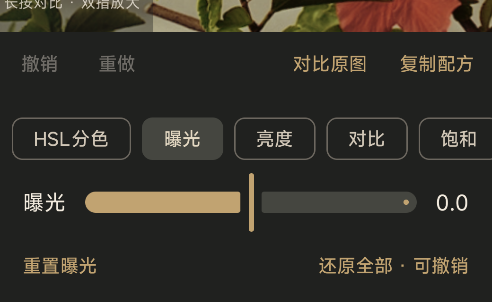
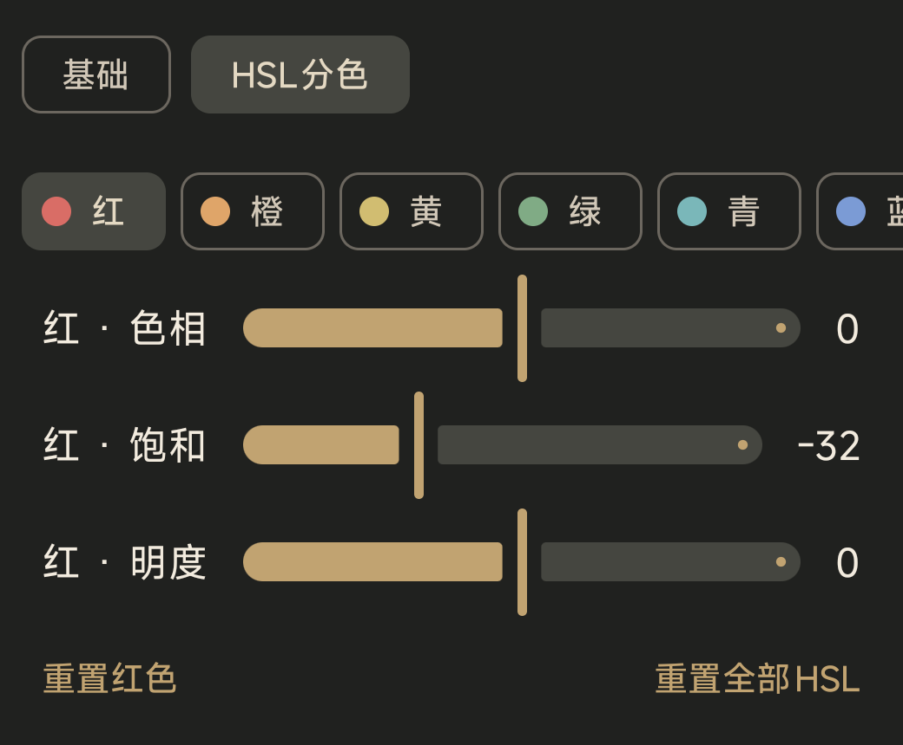
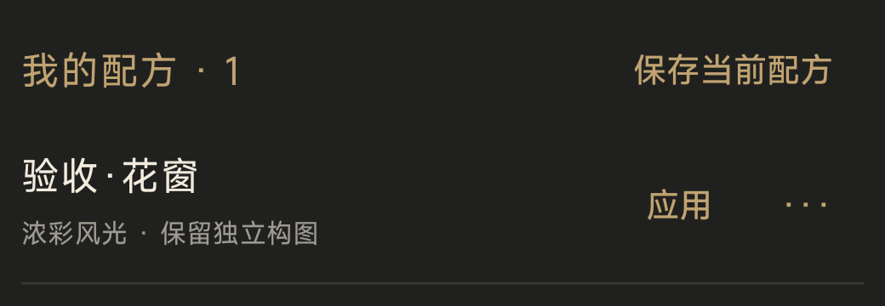
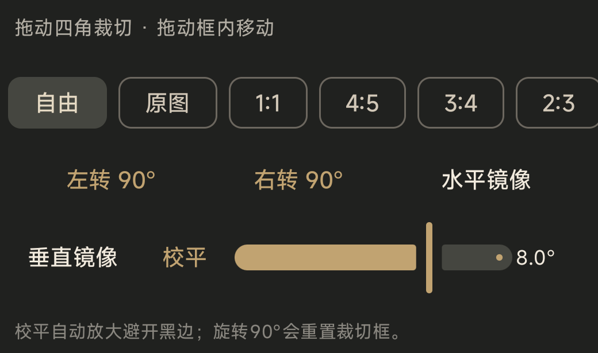

# 片屿 0.3.1 使用指南

## 导入与照片库

点“导入”打开 Android 系统相册，一次最多选择 100 张 JPG / HEIF。照片库保存的是应用私有的 URI 和编辑状态；片屿不复制或备份原图。原图被删除、相册撤销访问或应用数据被清除后，需要重新导入。

## 编辑

打开照片后，先从七款风格中选择一款，再调整强度、曝光、亮度、对比、饱和、高光、阴影、色温、色调、褪色、颗粒、锐化和暗角。HSL 分色可以分别调整八个色区。长按预览对比原图，双指缩放；工具栏提供撤销、重做和恢复全图。

“裁切 / 旋转”提供自由或锁定比例、拖动裁切框、左右 90° 旋转、双向镜像和 ±20° 校平。点“完成”提交构图，点“取消”放弃本次构图。

## 配方与批量

“复制配方”只复制当前风格和调色参数，不复制裁切、旋转或镜像。回到照片库多选后点“套用配方”。在“配方”页可命名保存、应用、改名和删除个人配方；删除配方不会改变已经编辑的照片。

## 导出

单图可以保存或打开系统分享选择器；照片库多选后可以批量保存，界面显示进度和失败数，也可停止后续任务。输出为 sRGB JPEG（质量 92），长边可选 1080 或 2048，小图不会被放大，保存到 `Pictures/片屿`。片屿不覆盖原片，也不保留定位、EXIF 等元数据。导出期间保持应用打开；进程被杀后不会自动续传。

七款风格参考：日常暖色（Portra 400）、电影日光（Vision3 250D）、夜色光晕（CineStill 800T）、自然正片（Provia 100F）、浓彩风光（Velvia 100）、克制复古（Kodachrome 64）、柔和黑白（Neopan Acros 100 II）。参考名称描述材料和审美方向，不表示真实胶片的唯一颜色。
