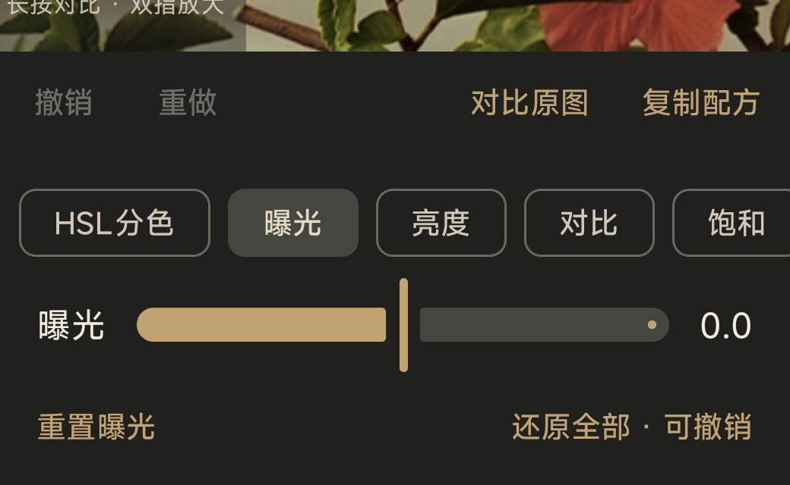
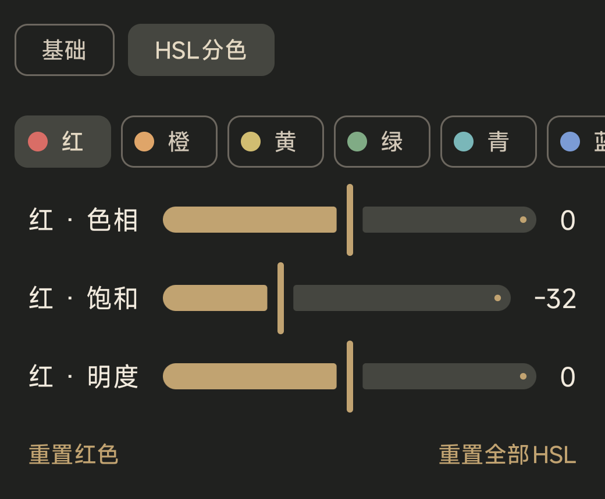
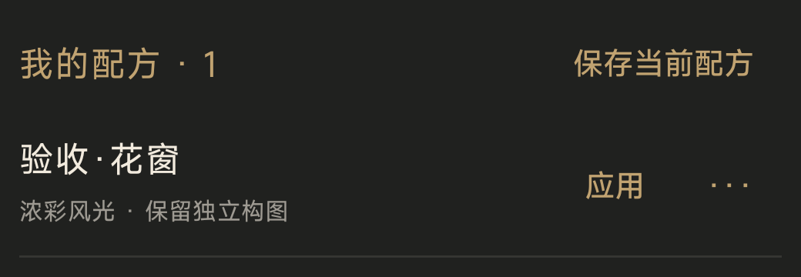
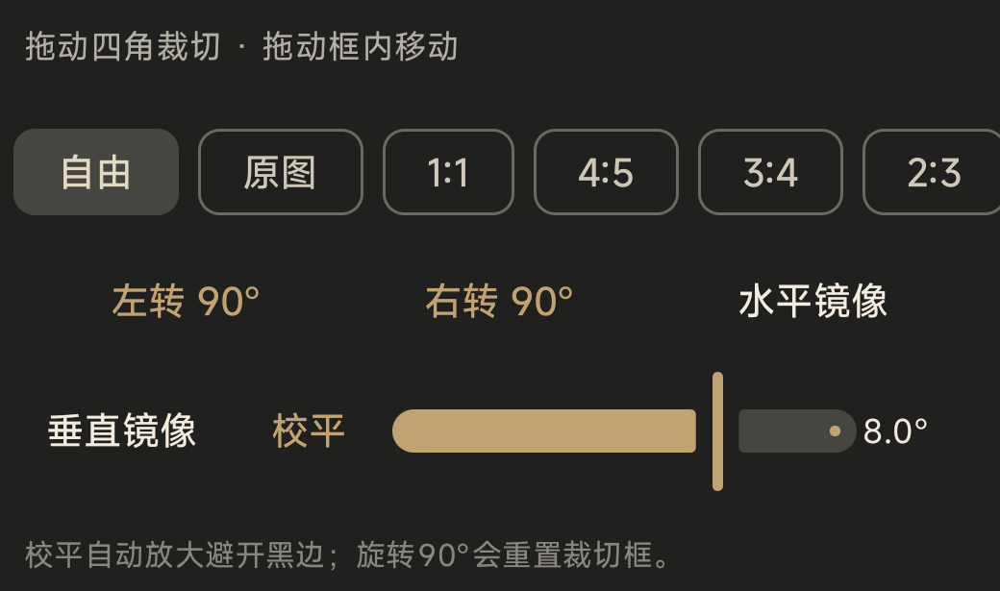

# 片屿使用指南（含0.3.3-preview2）

## 导入与照片库

点“导入”打开 Android 系统相册，一次最多选择 100 张 JPG / HEIF。照片库保存的是应用私有的 URI 和编辑状态；片屿不复制或备份原图。原图被删除、相册撤销访问或应用数据被清除后，需要重新导入。

v14会先跳过重复条目，再分段读取新照片信息，显示“已读取 n / 总数”。导入期间避免重复打开选择器；缩略图按可见需要读取，不在导入时生成全部胶片效果。

照片库优先展示已保存的当前效果缩略图，否则先显示标为“原图预览”的240长边缩略图，浏览图库不触发胶片GPU渲染。点开照片才生成编辑预览。读取失败会显示文字，已有配方不会因此丢失。[OPPO内存问题调查](OPPO-v10-INVESTIGATION.md)记录了v10修复；用户随后反馈OPPO正常。

## 编辑

打开照片后，先从七款风格中选择一款，再调整强度、曝光、亮度、对比、饱和、高光、阴影、色温、色调、褪色、颗粒、锐化和暗角。HSL 分色可以分别调整八个色区。长按预览对比原图，双指缩放；工具栏提供撤销、重做和恢复全图。

v11新照片默认强度75（推荐配方）、轻颗粒约12.5/100、胶片曝光手动补偿0，并开启保护高光自动测光。100提供更强的风格余量，不是准确率。点击强度数值可直接输入。切换风格保留手动调节的颗粒、曝光和测光状态。旧编辑效果保持，v2旧100显示为等效75，不自动重新曝光。[依据和验证边界](DEFAULT-WORKFLOW-v11.md)。

预览内存分配失败时最多以640长边重试一次，不改变导出尺寸。出现处理错误可点提示中的“查看”，也可回到照片库点“关于 → 处理诊断”复制最近报告。报告仅保存在本机。v10修复了Android误执行桌面大缓冲探针的问题，用户随后反馈OPPO恢复正常；其他设备或新问题仍需独立定位。

“胶片曝光”在进入胶片响应前调整±2EV，会影响胶片的色彩和明暗层次；建议从±0.3EV尝试。旁边的“自动测光”先计算曝光起点，手动EV再叠加补偿；关闭开关保留原图起点，适合需要保留夜景/舞台明暗的创作。自动测光也可能压暗照片，不保证张张更好看。原“曝光”是成片后的整体提亮或压暗，两者不能按相同数值等同。风格强度0时不应用胶片曝光和测光。调节停顿约120ms后开始渲染，松手提交。

v13在自动测光开关旁可以选择“均衡”“中心”“保护高光”“保护阴影”。默认仍是保护高光；均衡适合希望整体明暗更居中的画面，中心侧重画面中央，保护阴影适合主动提起暗部。夜景中均衡或保护阴影可能明显提亮现场，不会自动判断你的创作意图。关闭再开启开关会记住所选方式。旧配方的“旧版中央加权”仍按原算法处理；它与新“中心”不同，只有你主动改选才改变。

“调色 → 相纸与印放”是可选的第二层控制。先用推荐搭配即可；日常暖色可选Ultra Endura和富士Crystal Archive Type II，“更多相纸”保留Supra Endura与Endura Premier。电影风格可在2383/2393拷贝片间选择，黑白保留已验证的Ilford搭配。目前只开放这几组实测搭配，并非其他跨组搭配物理上不可行。自然正片、浓彩风光和克制复古直接扫描，不经过相纸，页面会说明原因。

“印放曝光”±2EV作用在相纸/拷贝片受到的光量上：+0.5EV对应光量乘√2，**不等于成片变亮0.5EV**，负片冲印中可能让结果压暗。想改变胶片响应用“胶片曝光”，想最后整体提亮用“曝光”。“恢复推荐冲印”只重置材料和印放曝光，可撤销。切换风格也恢复该风格推荐冲印；配方和批量套用会包含测光、材料与印放曝光，仍不复制构图。实测依据见[测光与冲印研究](METERING-PRINT-STUDY-v13.md)。

编辑预览长边约 960，不能代表全分辨率输出。风格选择条的缩略图统一展示默认风格，不随曝光、HSL 等个人调节更新；当前结果以大图为准。颗粒 UI 的 0–100 映射到引擎 0–2；拖动停顿约 120ms 后更新预览，松手提交；放大预览可以观察颗粒，颗粒效果随风格强度变化。

基础调色和 HSL 的数值按钮点按后会打开输入框。曝光按 EV 显示两位小数，其他参数按 UI 百分数显示；输入超出范围时不能应用。点击“应用”写入并形成可撤销的一步，点击“取消”或关闭输入框则放弃本次输入。未改动预填数值时保留原始浮点值。

风格由上游胶片材料模型和片屿额外预设组成。点“风格说明”可关闭额外预设，保留胶片模型与自己的滑块、颗粒和构图设置；支持撤销。重新选择任一风格恢复片屿预设。旧编辑继续使用保存的版本，不会自动改色。参考名称不是唯一颜色保证，详见 [胶片性格复核](FILM-CHARACTER-AUDIT.md)。

“裁切 / 旋转”提供自由或锁定比例、拖动裁切框、左右 90° 旋转、双向镜像和 ±20° 校平。点“完成”提交构图，点“取消”放弃本次构图。

## 配方与批量

“复制配方”只复制当前风格和调色参数，不复制裁切、旋转或镜像。回到照片库多选后点“套用配方”。在“配方”页可命名保存、应用、改名和删除个人配方；删除配方不会改变已经编辑的照片。

## 导出

单图可以保存或打开系统分享选择器；照片库多选后可以批量保存，界面显示进度和失败数，也可停止后续任务。v14完成后保留结果和逐张失败原因；点“仅重试失败”不会重复保存已成功的照片。GPU设备失效时会重建引擎，按原参数自动重试一次；不会静默缩小尺寸或关闭颗粒、测光。其他错误保留在结果及“关于 → 处理诊断”。

编辑后默认导出原尺寸 8-bit sRGB JPEG（质量 100，高质量但仍有损），也可选择长边 1080 或 2048，或选择编辑后的 8-bit sRGB PNG（像素无损，但不是 RAW/HDR 无损）。小图不会被放大，保存到 `Pictures/片屿`。编辑后分享不含原始定位或 EXIF 等元数据；“分享原片”会逐字节复制源文件，保留原始元数据且不含编辑。导出期间保持应用打开；进程被杀后不会自动续传。只有明确报告内存分配失败时，才考虑关闭其他应用或主动选择较小尺寸。

七款风格参考：日常暖色（Portra 400）、电影日光（Vision3 250D）、夜色光晕（CineStill 800T）、自然正片（Provia 100F）、浓彩风光（Velvia 100）、克制复古（Kodachrome 64）、柔和黑白（Neopan Acros 100 II）。参考名称描述材料和审美方向，不表示真实胶片的唯一颜色。完整历史参考说明见 [`FILM-STUDY.md`](FILM-STUDY.md)，配方复现见 [`RECIPE-STUDY.md`](RECIPE-STUDY.md)。

当前样片资料提供默认风格、同图同强度比较与白马累计配方，包含输入、Android 输出、JSON 和哈希。输入为AI生成的手机摄影风格图，不是实拍；异场景胶片参考仅用于风格分析。[第三版介绍片](PROMO-V3-AUDIT.md)用完整口播配合实际输出与参数，展示的是胶片曝光默认为0的versionCode7效果。旧15段、248.52秒视频和132秒第二版保留作实验记录，不代表当前成片。

白马样片在追加比较 19 个候选后，改用自然正片重新输出 4 个累计阶段；[重调前后对比与完整参数](film-study/PRAIRIE-REVISION.md) 保留旧版，视频已同步更新。

## v12 推荐起点与HEIF

风格说明内点击“重置此风格调色”，恢复当前风格的推荐调色、开启自动测光，保留构图且可撤销。胶片曝光0表示自动测光后的额外补偿为0，仍有胶片响应。旧照片需主动点击才改用新起点。

导出格式可选JPEG、PNG、HEIF；HEIF保存、分享编辑后照片与批量导出均支持原尺寸，使用设备编码器，没有JPEG中转。当前是8-bit sRGB SDR，不能保证原HEIF的HDR/10-bit信息保留。编码失败可改选JPEG/PNG。完整说明见[HEIF与推荐起点](HEIF-AND-RECOMMENDED-v12.md)。
