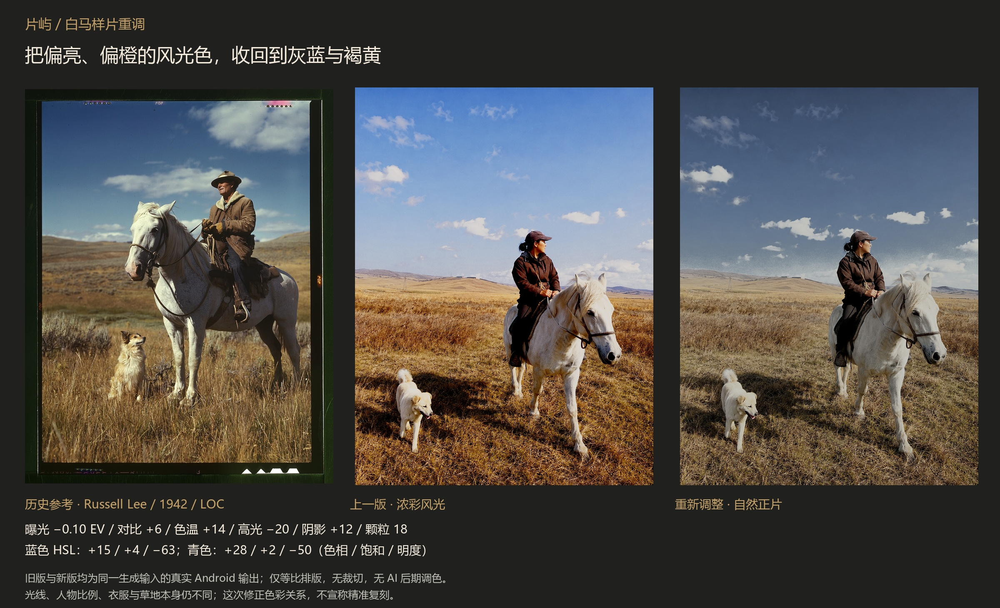

# 白马样片：第二版调整记录

> 本页保留早期候选的历史样片，不代表v12默认效果。完整研究压缩包未作为本次Release附件；本仓库公开比较图、累计阶段和JSON参数。

上一版的问题确实明显：天空过亮且偏鲜蓝，草地偏橙黄；对比加到18、阴影降低5，让衣服与马腿暗部更硬。它形成了一张更浓的风光照片，和参考里的灰蓝天空、褐黄草地与米白马匹仍有较大距离。

这次实际比较了19个额外候选，包含去色过头的灰天方案以及几个仍偏青的方案。最终从“浓彩风光”改为“自然正片”，强度100。曝光−0.10 EV，对比+6、饱和−3、色温+14、色调−6、高光−20、阴影+12、褪色3、颗粒18；亮度、锐化、暗角为0。

| HSL 色区 | 色相 | 饱和 | 明度 |
| --- | ---: | ---: | ---: |
| 红 | 0 | 0 | 0 |
| 橙 | 0 | −8 | −2 |
| 黄 | −4 | −2 | −8 |
| 绿 | −8 | −30 | −8 |
| 青 | +28 | +2 | −50 |
| 蓝 | +15 | +4 | −63 |
| 紫 | 0 | 0 | 0 |
| 洋红 | 0 | 0 | 0 |

主要变化来自蓝、青的明度与色相，并不是把整张照片压暗。减轻整体对比并提一点阴影后，马腿和衣服保留更多信息；橙黄分区控制草地，避免上一版浓重的橙色。所有阶段均在同一 Redmi K80 Pro 上通过片屿实际管线输出。没有重新生成输入，没有使用外部调色软件。

历史参考的光线、主体比例、服装颜色、草地与扫描层次仍然不同。新的灰蓝与褐黄关系更接近参考方向，但这不是“已经复刻成功”的证明。原输入保持1086×1448；裁切、旋转和镜像均未使用。

参考：[Russell Lee, 1942, LOC fsac.1a35022](https://www.loc.gov/item/2017878800/)。完整输入、旧版、四个累计处理阶段、全部JSON、候选记录和输出SHA-256均在发布资产 `pianyu-film-study.zip` 中。各阶段参数见 [prairie-manifest.json](prairie-manifest.json)，通用复现方法见 [RECIPE-STUDY.md](../RECIPE-STUDY.md)。
